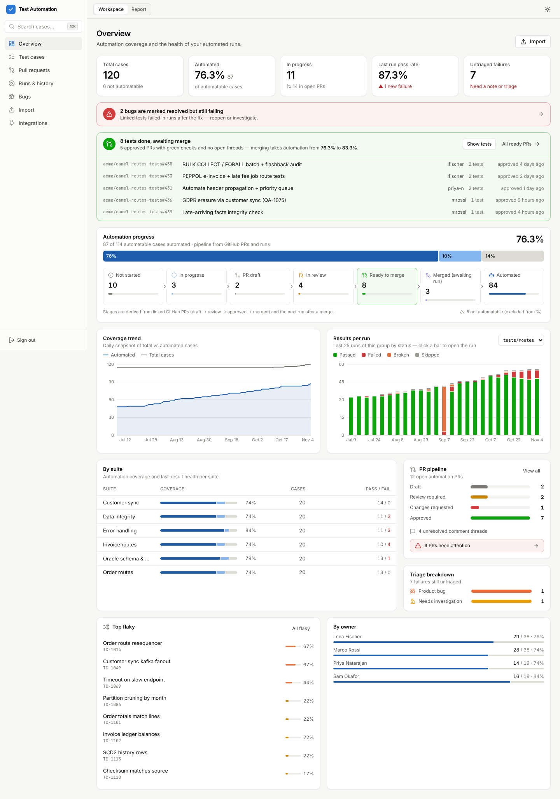
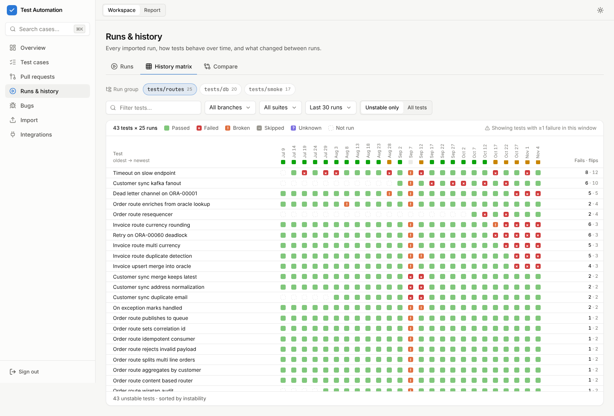
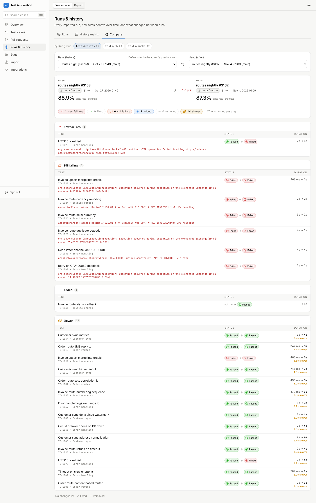
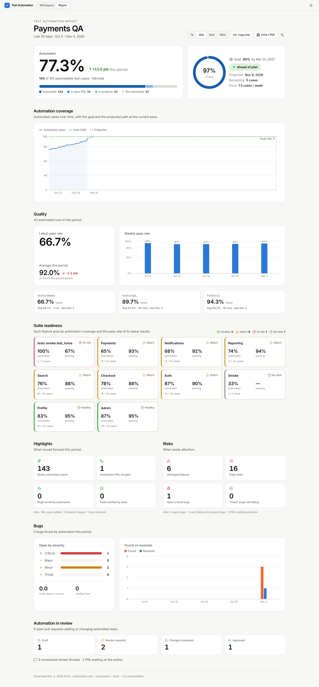
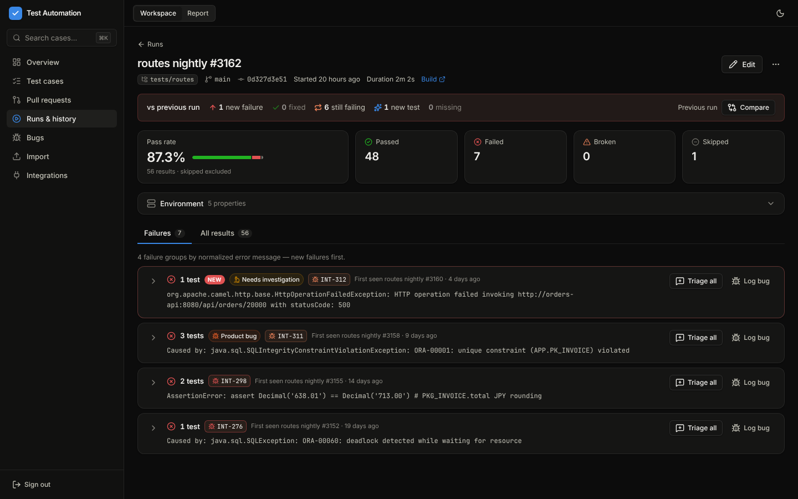

# Test Automation Dashboard

A self-hosted dashboard for teams that test with **pytest + Allure**. It answers two
questions: *how much of our test inventory is automated, and is that number going up?*
and *what failed last night, and is it new?* You upload `allure-results` from CI (or
by drag and drop), import the Excel or CSV tracker you already have, and the team
triages failures with notes, Jira links and bugs. Management gets a separate,
presentation-ready **Report** with goal tracking and a printable PDF.



## Features

The app has two sides. Editors use both; viewers see only the Report.

**Workspace** (the day-to-day tool for QA engineers)

- **Overview**: KPIs (total cases, automation rate, in progress, last-run pass rate,
  untriaged failures), coverage trend, results per run for each run group, suite and
  owner breakdowns, triage mix, top flaky tests, and the PR pipeline.
- **Automation pipeline (GitHub-driven)**: every case gets a derived stage — Not
  started → In progress → PR draft → In review → Ready to merge → Merged (awaiting run)
  → Automated. The Overview funnel links each stage to the filtered test list and
  calls out "N tests done, awaiting merge" with the approved PRs. When the sync sees a
  linked PR merged, its cases are promoted to `automated` automatically.
- **Triggers**: every Camel route trigger in the code, per branch, and which ones a
  test covers. Scan any branch of the route repo or the test repo straight from GitHub,
  and compare branches to see jobs and tests that diverge. When routes are scanned,
  they are the headline scope (see [Camel route triggers](#camel-route-triggers)).
- **Test cases**: a searchable, filterable, server-paginated inventory. You can edit
  the automation status inline, run bulk actions and export to CSV. Each case has a
  detail page with history per run group, a duration trend, the latest failure and
  its stack trace, a notes thread, linked bugs and linked PRs.
- **Runs and history**:
  - The runs list shows change chips (new failures, fixed).
  - Run detail compares the run with the previous one and groups failures by
    normalized error signature. You can triage a whole group at once. Signatures are
    Camel/Oracle aware: `ORA-`/`TNS-` codes, SQLSTATEs, HTTP statuses and exception
    class names are kept, exchange/message ids and timestamps are stripped, and
    connectivity failures (ORA-12541, TNS-*, connection refused, JMS broker down…)
    get a one-click "Looks like environment — apply?" suggestion.
  - The **history matrix** shows tests × runs as a heatmap.
  - **Compare** puts any two runs side by side.
- **Bugs**: Jira-linked defects with a verification state, for example "resolved but
  still failing". A `product_bug` note that has a Jira link creates the bug
  automatically.
- **Pull requests**: automation PRs from GitHub that are linked to test cases. Each
  one shows review state, unresolved threads and CI checks. You can filter by repo
  and author.
- **Import**: allure-results as a folder or `.zip`, and a spreadsheet wizard that
  maps columns and status values and runs a dry run before it commits.
- **Integrations**: sync tests and bugs from Jira/Xray, and PRs from GitHub.

**Report** (for management, also available to read-only viewers)

The Report shows aggregates only: no notes, traces or names. It includes:

- the automation rate and its change over the period;
- the goal, with a projected date and an ahead / on track / at risk / behind status;
- the coverage trend with the projection;
- pass-rate quality per run group;
- suite readiness;
- highlights and risks;
- bug metrics;
- the PR pipeline and automation in flight (in review, ready to merge, merged
  awaiting a run, and the projected rate once ready PRs merge).

**Print / PDF** uses a dedicated print stylesheet.

| | |
|---|---|
|  |  |
|  |  |

More screenshots, in light and dark themes at 1440 px and 375 px wide, are in
[`docs/screenshots/`](docs/screenshots/).

## Quickstart

Requirements: Node.js 22 or later, and pnpm 10 (run `corepack enable` to get it).

### Run it on your machine (recommended for a local install)

```bash
git clone https://github.com/jgold5/pytestdashboard.git
cd pytestdashboard
pnpm install
cp .env.example .env
```

Generate two secrets and paste them into `.env` as `DASHBOARD_TOKEN=` and `SESSION_SECRET=`
(run the command twice, one value each). Keep `DASHBOARD_TOKEN`: it is what you type on the login page.

```bash
node -e "console.log(require('crypto').randomBytes(32).toString('hex'))"
```

Build and start (re-run `pnpm build` after pulling updates):

```bash
pnpm build
pnpm start          # http://localhost:3000 → log in with DASHBOARD_TOKEN
```

Data lives in `apps/server/data/dashboard.db` (SQLite). Back up that folder.

To start fresh, empty it with one command. The server can keep running, and you stay
signed in: tokens and Jira/GitHub settings are in `.env`, not in the database.

```bash
pnpm reset-data          # lists what it will delete and asks first (--yes skips the question)
pnpm reset-data --all    # also clears the team name and goal from Settings
```

Then run a Jira/GitHub sync and scan your branches again.

Optional demo data, to look around before importing your own (stop the server first):

```bash
pnpm seed -- --reset    # 120 cases, ~60 runs, bugs, PRs — wipes the DB first
```

To let **teammates on your network** open it, set in `.env` (use your machine's IP) and restart:

```
PUBLIC_URL=http://192.168.1.50:3000
```

Optional `.env` extras: `VIEWER_TOKEN` (read-only Report login for managers), `INGEST_TOKEN`
(upload-only token for CI), Jira/GitHub settings (see [docs/INTEGRATIONS.md](docs/INTEGRATIONS.md)).
Each token must be ≥ 32 characters and different from the others.

### Development mode

```bash
pnpm dev                   # API on :3000, UI with hot reload on http://localhost:5173
```

With `DASHBOARD_TOKEN` empty, dev mode disables auth and listens on 127.0.0.1 only.

## Importing data

### Allure results

You can send results from the UI or from CI.

- **From the UI**: open **Import → Allure results** and drop the `allure-results`
  folder or a `.zip` of it. You can optionally fill in run name, run group, branch,
  commit and build URL. Only `*-result.json`, `environment.properties` and
  `executor.json` are uploaded.
- **From CI**: use `curl` with a Bearer token. Create a dedicated upload-only
  `INGEST_TOKEN` for this. It can only call `POST /api/runs/import`. Never give CI
  the editor token.

  ```bash
  cd allure-results && zip -qr ../allure-results.zip . && cd ..
  curl --fail-with-body -sS -X POST "$DASHBOARD_URL/api/runs/import" \
    -H "Authorization: Bearer $DASHBOARD_INGEST_TOKEN" \
    --form-string "runGroup=tests/api" \
    --form-string "branch=$BRANCH" --form-string "commit=$COMMIT" \
    --form-string "buildUrl=$BUILD_URL" \
    -F "files=@allure-results.zip;type=application/zip"
  ```

  For a complete GitHub Actions workflow, see
  [`docs/examples/upload-allure.yml`](docs/examples/upload-allure.yml). It pins
  actions by SHA, handles untrusted branch names safely, and skips the upload on
  fork PRs.

Results are linked to test cases in this order:

1. Allure ID, Jira key, or `tms` link;
2. Allure full name;
3. case key.

When nothing matches, a new case is created automatically. Retries in one upload
are deduplicated.

### Run history (allure-history / allureparser)

**Import → Run history** (or `POST /api/runs/import-history`, which also accepts the
`INGEST_TOKEN`) imports many runs in one upload. It reads uploads the same way
[allure-history](https://github.com/jgold5/allureparser) does:

- **Snapshots** (`*.snapshot.json.gz`, written by `allure-history snapshot`): each
  snapshot is one run, named after its label and linked to its build URL. Snapshots
  hold only the failure location, not the full stack trace.
- **Several allure-results folders** (for example `ci/build-12/allure-results/`, as a
  folder or a `.zip`): each folder is one run, named after `executor.json`'s
  `buildName`, or after the folder if there is none.
- **One allure-results folder that collected many runs**: runs are recovered from the
  host and pytest process ID that allure-pytest records on every result. The workers
  of a `pytest -n` run count as one run.

Runs the dashboard already has (same group, branch, start, stop and counts) are
skipped, so you can upload the same history folder again safely. Runs keep each
retry's status, so a test that fails and then passes on rerun counts towards
flakiness.

```bash
cd history && zip -qr ../history.zip . && cd ..
curl --fail-with-body -sS -X POST "$DASHBOARD_URL/api/runs/import-history" \
  -H "Authorization: Bearer $DASHBOARD_INGEST_TOKEN" \
  --form-string "runGroup=tests/api" --form-string "branch=main" \
  -F "files=@history.zip;type=application/zip"
```

### Xray cases automated by tests in the repo

With Jira/Xray synced (your Xray tests become test cases), the test repo itself can decide
what is automated. A test names the case it automates by its Xray key, anywhere in the test:
a comment above it, its docstring, a marker or a string:

```python
# Xray: ABC-123
def test_invoice_file_is_loaded(camel):
    """ABC-124: the INV file is picked up"""
```

Keys in a class docstring or a module docstring or comment apply to every test in that class
or file.

- **Main:** when the test repo's `main` (or `master`/`develop`) is scanned (**Scan a
  branch** on Triggers, or `POST /api/triggers/scan` with `only=tests`, see below), every case whose key a test names
  is marked **automated**, and its detail page shows "Automated via: named by a test on main".
  The scan never downgrades a case, and leaves cases marked *not automatable* alone.
- **PRs:** the GitHub sync links a PR to a case when an added line in a test file names the
  case's key (`key_in_test_diff`). The case then moves through the pipeline (PR draft → In
  review → Ready to merge) and is promoted to automated when the PR merges. Add your test
  folders to `GITHUB_TEST_PATH_GLOBS` (e.g. `**/route_test/**`).

### Camel route triggers

**Triggers** lists every Camel route that starts from a load file (`file:`, `ftp:`,
`ftps:`, `sftp:`, `smb:`) or a schedule (`quartz:`, `cron:`, `timer:`, `scheduler:`),
and which of them have a test. The routes and the tests can be in different repos.

**The triggers in the code are the scope.** It takes two scans:
1. **The trigger repo** (the Camel XML): every unique trigger on `main`.
2. **The test repo**: every trigger with one or more tests.

Once a route scan exists, the headline numbers on Overview and Report count triggers, not
spreadsheet or Jira rows:
- **Unique triggers**: the triggers in `main`'s Camel code;
- **Triggers tested**: those a test covers on `main` *or on any scanned branch*, merged or
  not; the Overview says how many are not merged yet;
- **No test yet**: the rest.

**Routes and tests are picked separately.** The **Routes** picker chooses the trigger repo
branch (whose triggers are the scope); the **Tests** picker chooses the test repo branch whose
merged tests count, plus the open PRs into it. By default the tests branch has the same name as
the routes branch (else the test repo's default), so "routes from core, tests from main" is one
pick away.

**Every page counts one branch of the trigger repo.** Picking `core` means `core`'s triggers,
tested by `core`'s merged tests plus every open PR into `core` (scanned with Scan open PRs);
other branches' tests never count. There is no "all branches" view. The Triggers page lists
only trigger repo branches, follows the branch and folder picked on the Overview (and back),
and marks a test that is only in a PR with that PR's branch.

**Pick the branch and folder** at the top of the Overview (and the Report) to count one branch
of the trigger repo, or only one folder in it: the folder under `resources/` (e.g.
`src/main/resources/common/…` is `common`). The pick stays until you change it, and the
Report's **Copy link** carries it. A branch without its own test scan uses `main`'s tests.
The coverage trend always follows the whole default branch. On Triggers, the tiles follow the
folder, type and search filters.

**Scan open PRs.** On Triggers, **Scan open PRs** scans the branch of every open PR in the
test repo (same repo, not forks) as tests, 3 at a time, until all are done, with a live list.
- It works once the test repo has been scanned as tests from the dashboard (Scan a branch →
  It holds: tests). The Camel repo's PRs are never scanned this way.
- Each PR shows **Up to date** when it was already scanned at its latest commit: it is
  skipped, so running it again only downloads PRs that moved. Failed ones are tried again.
- Scans of PRs that were merged or closed since are removed.
- It runs only when you click it; the GitHub sync doesn't scan branches.

A PR's tests count as *not merged yet* only for **the branch the PR targets**. With `core`
and `dev` both in the trigger repo, a PR into `dev` counts for `dev`, never for `core`, and
the test repo's own `dev` branch is `dev`'s merged tests, not "not merged" for `core`.
Branches scanned by hand or from CI without a PR count toward the default branch only.

The Camel repo's PRs are not scanned this way. The Integrations page shows what the last sync
did. To count a branch that has no PR, scan it by hand.

A branch's tests keep counting until its scans are removed: pick the branch on Triggers and
use the bin icon (or `DELETE /api/triggers/branches/<branch>`) once it is abandoned.

Before the first route scan, the numbers still count test cases.

#### Scan a branch from GitHub

Jobs differ between branches, so any branch of either repo can be scanned on demand:
**Triggers → Scan a branch**, pick the repository, say whether it holds the routes or the
tests (remembered per repo), and type or pick the branch. The dashboard downloads that
branch's archive from GitHub, scans it, and stores it like an uploaded scan (with the
commit it was taken at).

- Only repos listed in `GITHUB_REPOS` can be scanned, with `GITHUB_TOKEN` (it needs
  **Contents: read**). Editors only; viewers and the ingest token can't start one.
- API: `GET /api/triggers/github` (configured repos), `GET /api/triggers/github/branches?repo=`
  and `POST /api/triggers/scan-github` with `{"repo","branch","only":"routes"|"tests"}`.
- Archives are capped at 1 GB. The token is never sent to the download host.

#### Divergence between branches

Pick a branch and **Compare with** another one (usually `main`). Besides new, changed and
removed triggers, the page shows:
- triggers that **lost their test** on this branch;
- a **Divergence** card listing tests and Xray keys that exist on the other branch but are
  missing on this one, and the ones only this branch has. This catches cases that were
  added on one branch and never made it to another.

#### Uploading scans from CI

Instead of (or as well as) scanning from the dashboard, CI in each repo can upload a scan
on `main` and on every PR branch:

```bash
# Camel repo: route XML and properties
git ls-files '*.xml' '*.properties' | zip -q -@ scan.zip
curl --fail-with-body -sS -X POST "$DASHBOARD_URL/api/triggers/scan" \
  -H "Authorization: Bearer $DASHBOARD_INGEST_TOKEN" \
  --form-string "branch=$BRANCH" --form-string "commit=$COMMIT" --form-string "only=routes" \
  -F "files=@scan.zip;type=application/zip"

# Test repo: pytest files (only=tests ignores route copies kept there as test data).
# List the Python files your tests live in; every file sent is read as a test file.
git ls-files 'src/route_test/*.py' '*test_*.py' '*_test.py' | zip -q -@ scan.zip
curl --fail-with-body -sS -X POST "$DASHBOARD_URL/api/triggers/scan" \
  -H "Authorization: Bearer $DASHBOARD_INGEST_TOKEN" \
  --form-string "branch=$BRANCH" --form-string "commit=$COMMIT" --form-string "only=tests" \
  -F "files=@scan.zip;type=application/zip"
```

- **Branches across two repos.** The page joins each branch's latest route scan
  with its latest test scan. When a branch has only one of the two, the other comes
  from the default branch (`main`, `master` or `develop`). So a PR in the test repo is
  shown against `main`'s routes, and a PR in the Camel repo against `main`'s tests. The
  page says where each came from.
- **Reading the routes.** Routes are read from Camel XML: `<route id>` with its
  `<from uri>` (or `<from ref>` pointing at an `<endpoint>`). XML under `src/test/` is
  skipped, because it holds test fixtures. Route ids are scoped per module, meaning
  the folder under `resources/`, so the same id in two modules counts as two routes.
- **Placeholders.** `{{key}}` and `${key}` are filled in from the `.properties` file
  nearest to the route: the module's own file first, then shared ones higher up.
  When a key still has different values in different files, the page shows the
  placeholder and lists each value. It doesn't pick one.
- **Trigger files.** A route's `doneFileName` is shown as its trigger file: the file
  that has to exist before the data file is picked up. Load routes that pick up their data
  by `include=` and delete a marker file when they finish get that marker as their trigger
  file: `${file:parent}/LOADTRIGGER`, or a `setHeader`/`setProperty` such as
  `deleteFileName` / `doneFileName`. A test that drops the marker covers the route.
- **Plain names and defaults.** `include=EXTRACTRIGGER` matches that one name, and
  `{{key:DEFAULT}}` uses `DEFAULT` when no properties file sets `key`.
- **Several triggers in one route.** Each one counts separately:
  - each `<from>`, when a route has more than one;
  - each pattern, when `include=(INV|CRN)_.*` or `antInclude=INV_*.csv,CRN_*.csv` lists several;
  - each `<when>`/`<filter>` that tests the file name (`${file:name} starts with 'INV_'`,
    `${header.CamelFileName} regex '…'`), shown with the job it sends the file to.
- **What counts as a test covering a trigger.** One of the test's strings has to name
  the trigger's route ID, its schedule, the job a `<when>` sends files to
  (`direct:invoiceJob`), its trigger file, or a file it would pick up (for example
  `INV_20260101.csv` for `include=INV_.*\.csv`). The strings are read from:
  - decorators: Allure labels and pytest markers;
  - `pytestmark`;
  - string literals in the test body, such as a trigger file the test drops.

  `parametrize` values don't count. The page shows which string made each match.
- **Compare with** another trigger repo branch (e.g. `main`) to see what a branch adds,
  changes or removes, and which triggers it newly automates; the other side counts only
  its merged tests.
- **Cleaning up.** Remove an abandoned branch's scans with the bin icon next to the branch
  picker on Triggers, or `DELETE /api/triggers/branches/<branch>`.

To share how your routes and tests are written without sharing the code, run
[`tools/distill_camel_repo.py`](tools/distill_camel_repo.py) (Python 3.9+, no
packages) over both repos in one go:

```bash
python3 tools/distill_camel_repo.py /path/to/camel-repo /path/to/test-repo -o distilled --zip
```

It writes a copy that keeps only:
- the route inputs and their file-name `<choice>` branches;
- the properties those use;
- each test's decorators, `pytestmark`, and the short strings in its body.

Every name and value is replaced by a generic word, and numbers by stand-ins of the
same length. The replacement is the same in every file and both repos, so tests
still line up with their routes. Passwords and user names in URIs become `REDACTED`.
`distilled/distill-report.md` counts which trigger shapes the repo uses.

Share `distilled.zip`, but keep `distilled.map.json` (original → generic) to yourself.
`--map distilled.map.json` makes a later run reuse the same renaming. The zip can be
uploaded to `/api/triggers/scan` as is.

### Run groups

Every run belongs to a **run group**: a set of tests that are meant to be compared
with each other, for example `tests/api`, `tests/ui` or `smoke`.

- Runs are only ever compared within the same group and branch. This baseline
  drives "new failure", "fixed", the history matrix, Compare and flakiness. A smoke
  run is never compared with the full regression suite.
- If you leave the group blank, it is derived from the tests' common folder (for
  example `tests.api.users.test_login` gives `tests/api/users`). The import then
  shows a note that says which group was detected.
- Set the group explicitly in CI (`runGroup=...`) when the same folder runs in
  different configurations.

### Spreadsheet tracker

Go to **Import → Spreadsheet** and upload a `.xlsx`, `.csv` or `.tsv` file. The
wizard then takes you through these steps:

1. Pick the sheet.
2. Check the suggested column mapping. "Test ID", "Automated?", "Owner" and similar
   headers are recognized.
3. Map each distinct status value to an automation status.
4. Run a dry run.
5. Commit.

Rows are upserted by key, and errors are reported per row.

## Integrations

Jira/Xray syncs test cases, automation status and the status of linked bugs. GitHub
syncs automation PRs, review state and CI checks. Credentials come **only** from
environment variables; the UI can trigger a sync but can never read or change
credentials or URLs. Xray Cloud regions are supported through `XRAY_BASE_URL`.

Setup, token permissions and troubleshooting are in
**[docs/INTEGRATIONS.md](docs/INTEGRATIONS.md)**.

## Deployment

The app is a single Node process that serves both `/api` and the SPA, with SQLite
stored in `DATA_DIR`.

### Docker

```bash
docker build -t test-dashboard .
docker run -d --name test-dashboard -p 3000:3000 \
  -v test-dashboard-data:/data \
  -e DASHBOARD_TOKEN="$(openssl rand -hex 32)" \
  -e SESSION_SECRET="$(openssl rand -hex 32)" \
  -e INGEST_TOKEN="$(openssl rand -hex 32)" \
  -e PUBLIC_URL=https://qa.example.com \
  -e TRUST_PROXY=1 \
  test-dashboard
```

The image is built in several stages and runs as the non-root `node` user. It
declares a `/data` volume and a `HEALTHCHECK` on `/api/health`. Back up the volume:
it holds `dashboard.db` together with its WAL files.

### Behind a reverse proxy (recommended)

Terminate TLS in nginx, Caddy, Traefik or your load balancer, then:

- **`PUBLIC_URL=https://qa.example.com`**: the URL users open. It is the server's
  own origin for the CSRF check. It makes the session cookie `Secure`, and it enables
  the Host-header allowlist, which protects against DNS rebinding. Add any other
  hostnames to `ALLOWED_HOSTS`.
- **`TRUST_PROXY`**: set this to the number of proxy hops (for example `1`) or to a
  comma-separated list of proxy IPs or CIDRs, so that rate limits use the real
  client IP. `true` is rejected. With a hop count, make sure the app is reachable
  **only** through the proxy, or use the IP list form.
- Forward `X-Forwarded-For` and `X-Forwarded-Proto` from the proxy. Allow request
  bodies of at least 200 MB for allure uploads (`client_max_body_size 200m;` in
  nginx).
- HSTS is sent in production. Keep the dashboard on its own origin; it sends
  `X-Frame-Options: DENY` and a strict CSP.

Every setting is documented in [`.env.example`](.env.example). In production the
server refuses to start without `DASHBOARD_TOKEN` and `SESSION_SECRET`, each at
least 32 characters.

## Security model

- **Tokens and roles.** There are no user accounts. Access is based on tokens:
  - `DASHBOARD_TOKEN` gives the **editor** role, which can do everything.
  - The optional `VIEWER_TOKEN` gives the **viewer** role, which can only read the
    Report and settings.
  - The optional `INGEST_TOKEN` gives the **ingest** role, which can only upload
    runs and cannot sign in to the UI.

  Browsers exchange a token for a signed, `httpOnly`, `SameSite=Strict` session
  cookie. CI sends `Authorization: Bearer`. The role is checked on the server for
  every route, based on the matched route. To revoke sessions, rotate
  `SESSION_SECRET` or the token they were issued for.
- **Request protections.**
  - CSRF: cookie-authenticated writes must come from an allowed `Origin`.
  - Rate limits: login and imports have their own stricter limits, and all API
    calls also share a global per-IP limit.
  - Every input is validated with zod.
  - Uploads are size-capped. Zip files are read in a streaming way with zip-slip,
    bomb and amplification checks.
  - Spreadsheets are parsed in a resource-limited worker thread.
- **Stored data.** The SQLite database holds test cases, results (messages and
  traces are truncated), notes, author names typed into notes, bugs and PR metadata.
  Integration credentials are never stored or returned; error messages are stripped
  of secrets before they are saved.
- **Output.** There is no `dangerouslySetInnerHTML`, Markdown is rendered without
  raw HTML, and CSV exports are protected against formula injection.

The full threat review, findings and fixes are in
[docs/SECURITY_REVIEW.md](docs/SECURITY_REVIEW.md).

## Architecture

```
packages/shared   zod 4 schemas = the API contract (source of truth for server + web)
apps/server       Fastify 5 · better-sqlite3 + Drizzle · tsup bundle · serves the SPA
apps/web          React 19 · Vite · Tailwind v4 · TanStack Query · React Router · Recharts
e2e/              Playwright journeys against the production build
```

The product and technical spec, including the API route table and domain rules
(coverage math, run-group baselines, flakiness, triage, bug verification), is in
[docs/SPEC.md](docs/SPEC.md).

## Development

| Command | What it does |
|---|---|
| `pnpm dev` | Server (tsx watch) and Vite dev server |
| `pnpm lint` | ESLint across server, web, shared and e2e |
| `pnpm typecheck` | `tsc` for every package and for e2e |
| `pnpm test` | Unit and API tests (vitest, Fastify `inject`, in-memory temp DBs) |
| `pnpm build` | Web (Vite, code-split per route), then server (tsup) |
| `pnpm e2e` | Playwright: build → seed a temp `DATA_DIR` → start prod server → run journeys |
| `pnpm --filter @ptd/server seed -- --reset` | Demo data into `DATA_DIR` |

The e2e suite covers these journeys:

- login with a wrong token and with the right one;
- the viewer role being confined to the Report;
- Overview KPIs;
- allure zip import with a run group, and the import notes;
- run detail compared with the previous run, plus failure groups;
- a product-bug note that auto-creates a bug;
- the history matrix, including navigating from a cell;
- Compare;
- the spreadsheet wizard;
- inline status changes persisting after reload;
- the Report print layout and PDF export.

Set `E2E_SKIP_BUILD=1` to reuse an existing build. Set `PW_CHROMIUM_PATH` to use a
Chromium you already have installed. `@playwright/test` is pinned to an exact
version, so `pnpm exec playwright install chromium` fetches the browser that
matches it.

CI (`.github/workflows/ci.yml`) runs these steps:

1. install with a frozen lockfile;
2. lint;
3. typecheck;
4. unit tests;
5. build;
6. `pnpm audit --prod --audit-level high`;
7. e2e.

Actions are pinned by SHA, and Dependabot updates both the npm packages and the
actions every week.

## Roadmap / recommendations

- **SSO (OIDC) and per-user identity** instead of shared tokens. This would give
  real authorship, per-user revocation and an audit log.
- **Postgres** as an option, for multi-instance or high-availability deployments.
  SQLite is fine for a single instance.
- A **pytest plugin or GitHub Action** that uploads results automatically and fills
  in the run group, branch, commit and build URL.
- **Slack or Teams digests**: new failures, untriaged failures and "resolved but
  still failing" bugs after each nightly run.
- **Creating Jira issues** directly from a failure group, pre-filled with the
  signature, affected tests and run link.
- **Flaky-test quarantine**: a managed list with an owner and an expiry. Quarantined
  tests would be excluded from pass-rate KPIs but still tracked.
- Test **ownership from CODEOWNERS**; trends of duration regressions.
